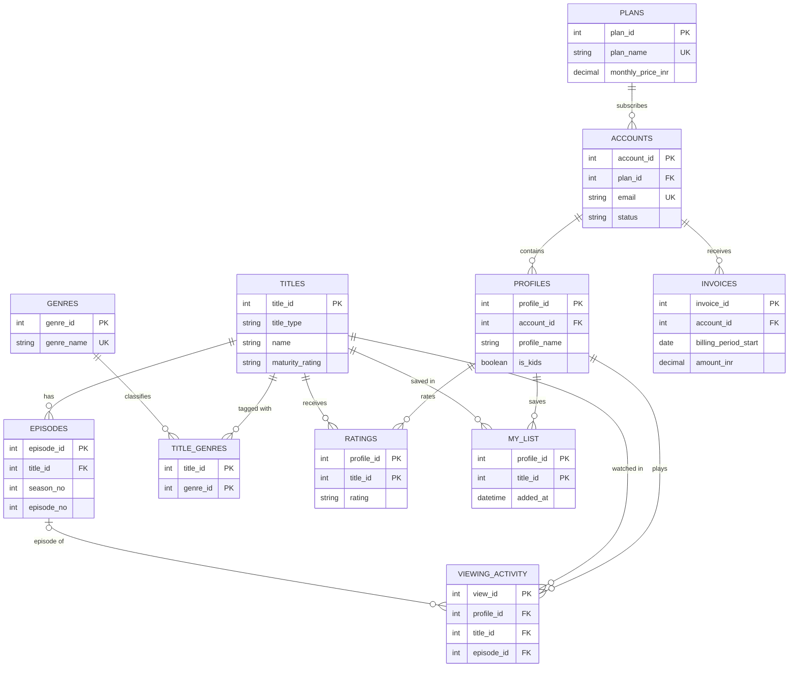

# Schema Design

The schema has 11 tables based on the 11 supplied CSV files. It retains the CSV headers, uses PostgreSQL types suitable for the data, and defines keys, foreign keys, `NOT NULL`, `UNIQUE`, and `CHECK` constraints. No workload-tuning indexes are added.

## Tables and data dictionary

| Table | Columns (type; constraints and reason) |
|---|---|
| `plans` | `plan_id` integer, PK; `plan_name` varchar(20), required, unique, MOBILE/BASIC/STANDARD/PREMIUM; `monthly_price_inr` numeric(8,2), required, non-negative; `max_streams` smallint, required, 1-4; `max_resolution` varchar(5), required, 480p/720p/1080p/4K; `has_ads` boolean, required. |
| `accounts` | `account_id` integer, PK; `email` varchar(254), required, unique, lowercase; `phone` varchar(20), optional and 10 digits when present; `country_code` char(2), required, IN/SG/AE; `(country_code, phone)` unique when phone is present; `plan_id` integer, required FK to `plans`; `signup_date` date, required; `status` varchar(10), required, ACTIVE/CANCELLED/ON_HOLD; `cancelled_on` and `next_billing_date` dates, conditionally nullable according to status. |
| `profiles` | `profile_id` integer, PK; `account_id` integer, required FK to `accounts`; `profile_name` varchar(50), required; `is_kids` boolean, required; `maturity_limit` varchar(5), required, U/UA7/UA13/UA16/A; `language` varchar(30), required; `created_at` timestamptz, required. Kids profiles are limited to U or UA7. |
| `genres` | `genre_id` integer, PK; `genre_name` varchar(30), required and unique. |
| `titles` | `title_id` integer, PK; `title_type` varchar(6), required, MOVIE/SERIES; `name` varchar(200), required; `release_year` smallint, required, 1888-2100; `maturity_rating` varchar(5), required, U/UA7/UA13/UA16/A; `original_language` varchar(30), required; `runtime_min` smallint, null for series and positive/required for movies; `is_netflix_original` boolean, required; `added_on` date, required; `leaving_on` date, optional and prohibited for originals. |
| `title_genres` | `title_id` integer, required FK to `titles`; `genre_id` integer, required FK to `genres`; composite PK `(title_id, genre_id)` prevents duplicate associations. |
| `episodes` | `episode_id` integer, PK; `title_id` integer, required FK to `titles`; `season_no` and `episode_no` smallint, required and positive; `episode_title` varchar(200), required; `runtime_min` smallint, required and positive; `release_date` date, required. `(title_id, season_no, episode_no)` is unique; `(episode_id, title_id)` is also unique for the composite viewing FK. |
| `viewing_activity` | `view_id` integer, PK; `profile_id` and `title_id` integers, required FKs to `profiles` and `titles`; `episode_id` integer, nullable for movies; `started_at` timestamptz, required; `duration_watched_sec` integer, required and positive; `device_type` varchar(10), required, TV/MOBILE/TABLET/LAPTOP; `completed` boolean, required. Composite FK `(episode_id, title_id)` ensures a referenced episode belongs to the viewed title. |
| `ratings` | `profile_id` and `title_id` integers, required FKs to `profiles` and `titles`; `rating` varchar(12), required, THUMBS_DOWN/THUMBS_UP/LOVE; `rated_at` timestamptz, required; composite PK `(profile_id, title_id)` allows one current rating per profile/title. |
| `my_list` | `profile_id` and `title_id` integers, required FKs to `profiles` and `titles`; `added_at` timestamptz, required; composite PK `(profile_id, title_id)` prevents duplicate saved titles. |
| `invoices` | `invoice_id` integer, PK; `account_id` integer, required FK to `accounts`; `billing_period_start` date, required and first day of a month; `amount_inr` numeric(8,2), required and non-negative; `status` varchar(8), required, PAID/FAILED/REFUNDED; `paid_at` timestamptz, null for FAILED and required for PAID/REFUNDED; `(account_id, billing_period_start)` unique. |

Parent references use `ON DELETE RESTRICT` to protect account, profile, title, episode, and invoice history. The `title_genres` junction uses `ON DELETE CASCADE` because its rows are only associations. PostgreSQL creates indexes for primary keys and unique constraints; there are no other indexes in this phase.

## Relationships and cardinalities

- One plan has zero or more accounts; every account has one plan.
- One account has zero or more profiles; every profile belongs to one account. The seed data has 1-5 profiles per account. The maximum of five is a cross-row rule and is verified by a query rather than a `CHECK`.
- One series title has zero or more episodes; each episode belongs to one title.
- Titles and genres are many-to-many through `title_genres`.
- One profile has zero or more viewing rows, ratings, and My List entries.
- One title has zero or more viewing rows, ratings, and My List entries.
- One account has zero or more invoices.

### Mermaid Crow's Foot source

<!-- mermaid-checked: every attribute is `<type> <name> [<key>] ["<description>"]` with at most one of PK/FK/UK, no \n in descriptions, no {} in descriptions, every relationship label is double-quoted -->

Editable diagram files are [the Crow's Foot SVG](../diagrams/er_diagram_crow.svg), [the Crow's Foot Mermaid source](../diagrams/er_diagram_crow.mmd), and [the Chen SVG](../diagrams/er_diagram_chen.svg).

## Functional dependencies and normal forms

Each table has atomic fields (1NF). The determinants below are candidate keys; non-key attributes depend on the whole key and not on another non-key attribute, so the relations satisfy 3NF and BCNF.

| Table | Functional dependencies |
|---|---|
| `plans` | `plan_id -> plan_name, monthly_price_inr, max_streams, max_resolution, has_ads`; `plan_name -> plan_id, monthly_price_inr, max_streams, max_resolution, has_ads`. |
| `accounts` | `account_id -> email, phone, country_code, plan_id, signup_date, status, cancelled_on, next_billing_date`; `email -> account_id, ...`; `(country_code, phone) -> account_id, ...` for non-null phones. |
| `profiles` | `profile_id -> account_id, profile_name, is_kids, maturity_limit, language, created_at`. |
| `genres` | `genre_id -> genre_name`; `genre_name -> genre_id`. |
| `titles` | `title_id -> title_type, name, release_year, maturity_rating, original_language, runtime_min, is_netflix_original, added_on, leaving_on`. |
| `title_genres` | `(title_id, genre_id) -> no non-key attributes`. |
| `episodes` | `episode_id -> title_id, season_no, episode_no, episode_title, runtime_min, release_date`; `(title_id, season_no, episode_no) -> episode_id, episode_title, runtime_min, release_date`. |
| `viewing_activity` | `view_id -> profile_id, title_id, episode_id, started_at, duration_watched_sec, device_type, completed`. |
| `ratings` | `(profile_id, title_id) -> rating, rated_at`. |
| `my_list` | `(profile_id, title_id) -> added_at`. |
| `invoices` | `invoice_id -> account_id, billing_period_start, amount_inr, status, paid_at`; `(account_id, billing_period_start) -> invoice_id, amount_inr, status, paid_at`. |

### Redundant or retained values

- `viewing_activity.title_id` can be looked up through an episode for series plays, but is needed for movie plays and is used by the workload. The composite FK prevents a mismatched episode/title pair.
- `completed` is retained as the recorded playback outcome. A simple comparison between watch duration and runtime disagrees with the supplied completion flag on 20,333 rows.
- `invoices.amount_inr` is the historical charge for the billing period; it cannot safely be derived from an account's current plan price after plan changes.
- `title_genres` and `my_list` represent intentional many-to-many relationships.

## Loading and integrity-check results

From the repository root, run `psql -d <database> -f sql/01_schema.sql` and then `psql -d <database> -f sql/02_load_data.sql`. The loader imports parent tables first, runs `ANALYZE`, prints row counts, then runs the integrity checks below.

The schema and loader were tested on PostgreSQL 18 with the supplied seed data. Every table loaded the expected number of rows:

| Table | Rows |
|---|---:|
| `plans` | 4 |
| `accounts` | 25,000 |
| `profiles` | 75,000 |
| `genres` | 15 |
| `titles` | 3,000 |
| `title_genres` | 5,963 |
| `episodes` | 20,000 |
| `viewing_activity` | 200,401 |
| `ratings` | 33,900 |
| `my_list` | 59,992 |
| `invoices` | 133,057 |

| Integrity check | Violations |
|---|---:|
| Viewing episode belongs to the same title | 0 |
| Series/movie viewing rows have the correct episode nullness | 0 |
| Accounts with more than five profiles | 0 |
| Viewing starts before title was added | 0 |

Additional CSV checks found unique primary and composite keys, valid foreign-key references, unique lowercase account emails, unique present phone numbers, and no viewing activity before an episode's release. The workload file was also executed against the loaded schema; all 30 statements ran successfully.

### Nulls and data observations

- `accounts.phone` is blank for 4,888 accounts and is optional. `cancelled_on` is null for non-cancelled accounts; `next_billing_date` is null for cancelled accounts. The 739 `ON_HOLD` accounts have a next billing date.
- `titles.runtime_min` is null for all 1,000 series and present for all 2,000 movies. `leaving_on` is null for originals and for licensed titles without a departure date.
- `viewing_activity.episode_id` is null for all 93,056 movie plays and populated for all 107,345 series plays.
- `invoices.paid_at` is null for all 4,764 FAILED invoices and populated for PAID and REFUNDED invoices.
- The seed rows satisfy the allowed status, maturity, device, rating, and date rules. The five-profile maximum is a cross-row rule, verified by the loader query rather than a row-level `CHECK`.